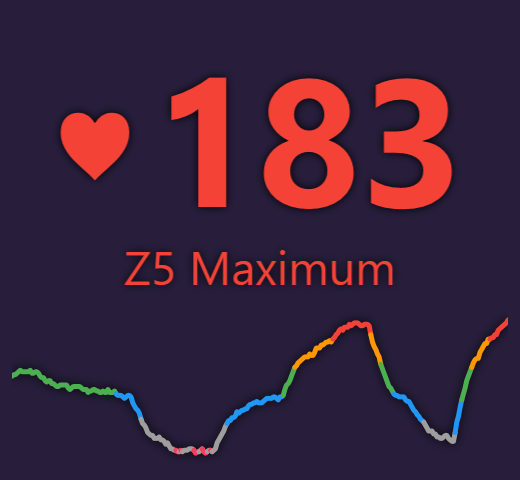
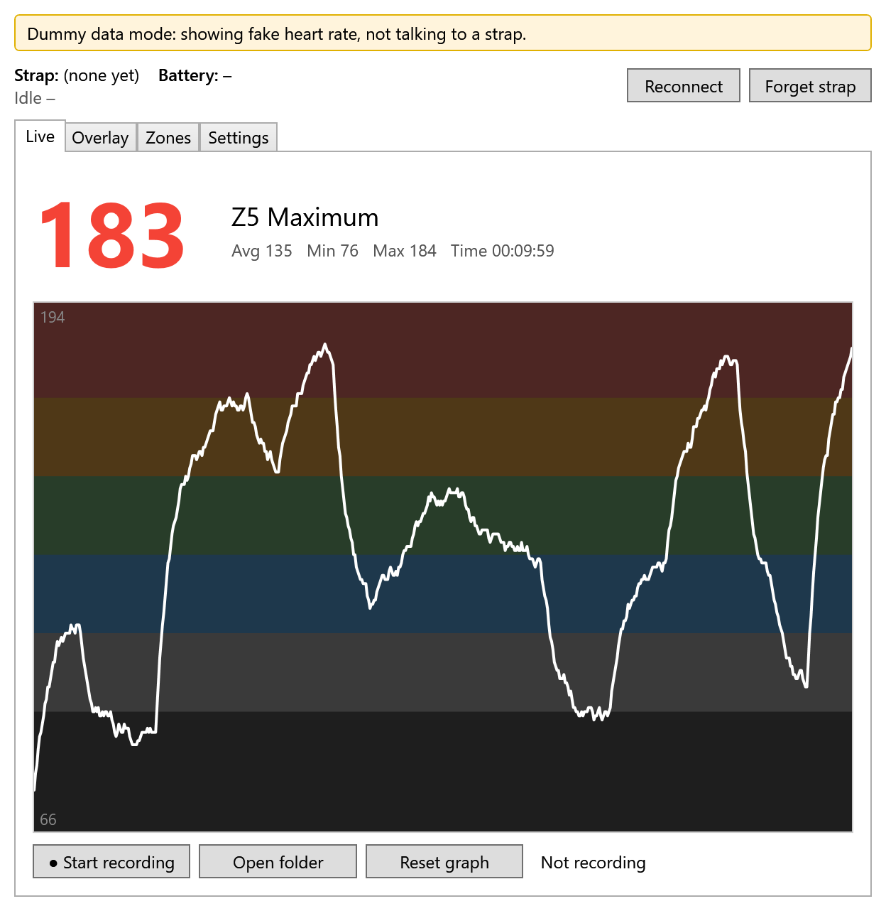

# HeartRateMonitor 💓

**Your live heart rate from a Bluetooth chest strap, as a big always-on-top number over your game.**

<p>
  
  
</p>

## Download

**[⬇ HeartRateMonitor.exe (latest)](https://github.com/RelentlessOldMan/HeartRateMonitor/releases/latest/download/HeartRateMonitor.exe)**: one standalone file for Windows 10/11, with no .NET install needed. Other versions and a `.zip` are on the [releases page](https://github.com/RelentlessOldMan/HeartRateMonitor/releases).

The exe isn't code-signed, so Windows SmartScreen may warn the first time: click **More info → Run anyway**.

## Why

I wanted to see my heart rate while playing a dance game: big, readable and in a color I pick, without alt-tabbing to a phone app.

## Usage

1. Put the strap on (wet the sensor pads) and disconnect it from your phone or watch. Most straps only talk to one device at a time.
2. Run `HeartRateMonitor.exe`. It connects to the first heart rate strap it finds and remembers it from then on. You don't need to pair it in Windows.
3. Drag the overlay where you want it and drag its corner to resize it. Then tick **Lock overlay** so clicks go straight through to the game.

Run your game in **borderless/windowed** mode. Exclusive fullscreen draws over every other window, including always-on-top ones.

**Features**
- Overlay: the number scales with the window. You can choose the font, a fixed color or color by zone, a glow outline, a background color with any opacity, a heart that beats at your actual BPM, the zone name and a live graph of the last 1–30 minutes.
- Heart rate zones: generated from your max heart rate (50/60/70/80/90%) or fully custom names, thresholds and colors.
- Daily stats: time in each zone today, kept across restarts. Stored per BPM, so editing your zones re-sorts the whole day.
- Recording: writes a CSV as you go (timestamp, BPM, RR intervals, skin contact) and optionally a `.tcx` you can upload to Strava or Garmin Connect.
- Reconnects automatically if the strap drops out. Settings are saved as you change them.

**Command line**
- `--dummy`: fake heart rate data, for trying it out without a strap.
- `--snapshot <folder>`: renders every screen to PNGs off-screen and exits (used for the screenshots above).

Tested with a Coospo H808S. Any strap that speaks the standard Bluetooth LE Heart Rate profile should work (Polar, Garmin HRM-Dual, Wahoo TICKR, …).

## How it works

The strap broadcasts the standard Bluetooth LE Heart Rate service (`0x180D`). The app scans for its advertisement, connects through the Windows WinRT Bluetooth APIs and subscribes to the Heart Rate Measurement characteristic (`0x2A37`), which sends BPM plus beat-to-beat RR intervals about once a second. It also reads battery level when the strap offers it. The overlay is a transparent, topmost WPF window. Locking it adds `WS_EX_TRANSPARENT` so mouse input passes through.

## Layout

```
HeartRateMonitor/
  Sensors/      BLE strap connection, measurement parser, dummy data source
  Recording/    CSV + TCX session recorder
  Controls/     Zone-colored graph, brush cache, converters
  Models/       Settings (JSON in %AppData%\HeartRateMonitor), zones, samples
  OverlayWindow.xaml   The always-on-top display
  MainWindow.xaml      Connection, overlay options, zones, recording
  Snapshot.cs          Off-screen rendering for --snapshot
.github/workflows/release.yml   Bump <Version> in the csproj and push to get a new release
```

## Contributing

This is a personal tool, published as-is — **issues and pull requests aren't accepted** (PRs auto-close). Fork it and make it your own. 💓

## License

MIT — see [LICENSE](LICENSE). © 2026 RelentlessOldMan.
